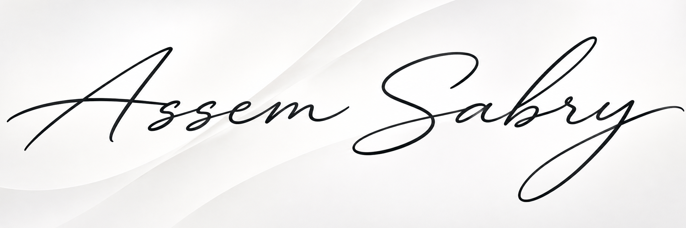

  

  <h1>AI Engineer & Researcher | Founder & CEO of <a href="https://tokenai.llc/">TokenAI</a></h1>

  
  
  

  <em>I like training deep neural networks :&gt;</em>

<h2 align="center">About Me</h2>

My journey in Artificial Intelligence spans from foundational learning to pioneering research and professional enterprise solutions. I'm a researcher with **3 academic papers** and **4 research projects** in AI. Here is a brief timeline of my professional experience:

- **Learning Programming & Computer Vision (2021 - 2023):** Started my journey focusing on computer vision techniques and foundational coding skills.
- **AI Engineering (2023 - Present):** Building and deploying intelligent systems, mastering machine learning algorithms, and advanced AI architectures.
- **Freelancing (2024 - Present):** Providing professional AI and software development services to clients worldwide.
- **AI & ML Research (2025 - Present):** Actively conducting research to explore cutting-edge technologies and innovative solutions.
- **Founding TokenAI (10 May 2025 - Present):** Founded my non-profit AI Startup **TokenAI**.

> **TokenAI** builds advanced AI models, research, datasets, and developer tools.
> We focus on language, multimodal, speech, cybersecurity, and Arabic-native intelligence.
> Our mission is to make advanced intelligence accessible and useful for everyone.
>
> Learn more at [tokenai.llc](https://tokenai.llc/)

---

<h2 align="center">Horus AI Models Family</h2>

I'm the creator of the **Horus models family** at TokenAI. The Horus family has surpassed **250,000 downloads** worldwide.

[Explore the Horus models](https://tokenai.llc/models)

---

<h2 align="center">Researches</h2>

### Stable Training with Adaptive Momentum STAM

**Stable Training with Adaptive Momentum (STAM)** is an innovative optimization method that dynamically adapts the first-order momentum coefficient based on a per-tensor gradient variance proxy. Unlike traditional methods like Adam and AdamW that use a fixed momentum coefficient, STAM reduces overshooting in high-variance regimes to dampen oscillations while accelerating convergence in low-variance situations.

The research also introduces **STAMLite**, a highly memory-efficient variant that requires only O(1) extra state per parameter, matching the memory footprint of AdamW. Across comprehensive benchmark phases, STAM and STAMLite achieved top-3 performance on 83% of the scored phases and won outright on hyperparameter robustness.

**Learn more about the research here:**
[STAM Research Details](https://tokenai.llc/research/stam)

---

### SSRN Publication

The STAM research paper has been officially published and gained significant recognition, ranking among the top 500,000 globally on the SSRN platform. 

**Read the full Research Paper on SSRN:**
[Research Paper](https://papers.ssrn.com/sol3/papers.cfm?abstract_id=6699059)
